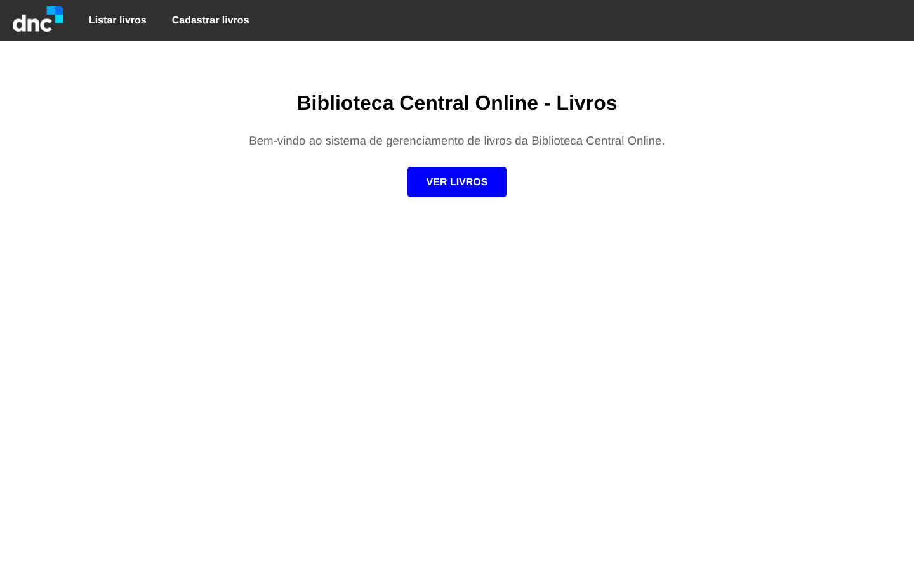
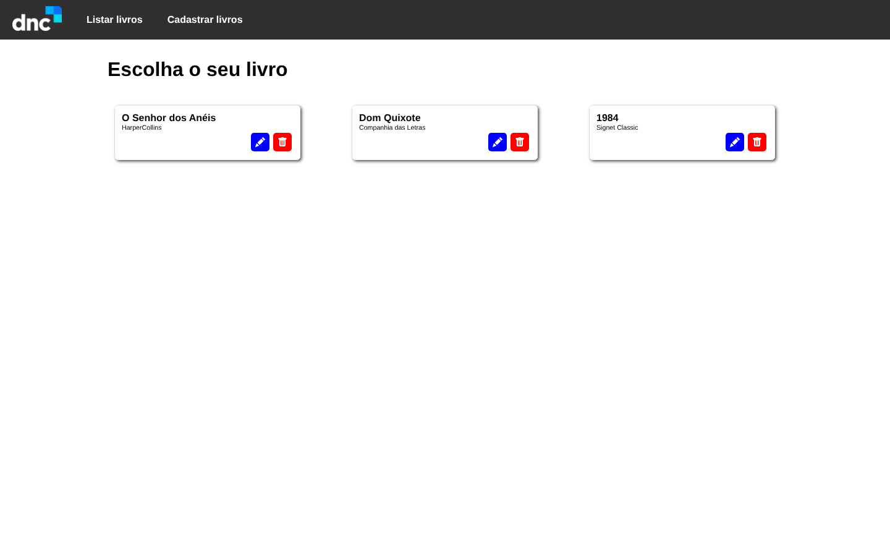
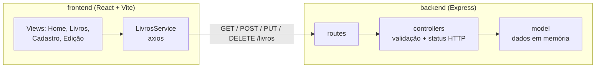

# Biblioteca Fullstack

    

Sistema de cadastro de livros com **API REST em Express e front-end em React** conversando entre si. Foi o primeiro projeto em que construí as duas pontas e liguei uma na outra.

Desafio de Node.js + React da formação **Engenheiro de Software (Escola DNC)**, entregue e aprovado na avaliação do projeto. Layout feito a partir de um protótipo no Figma.

<p align="center">
  
  &nbsp;
  
</p>

## Como as partes conversam



- **No front, uma camada só para a API.** As telas não chamam `axios` direto: tudo passa por `LivrosService`. Se a URL ou o formato mudar, muda em um lugar só.
- **No back, rota, controller e model separados.** A rota só aponta, o controller valida e escolhe o status HTTP (400 para campo faltando, 404 para livro inexistente), e o model guarda os dados.
- **Edição carrega o livro pela URL** (`/livros/edicao/:livroId` com `useParams`) e pré-preenche o formulário com o que veio da API.

## O que aprendi

- Ligar um front React a uma API própria: CORS e chamadas assíncronas com axios
- `useState` e `useEffect` para buscar dados ao abrir a tela e atualizar a lista depois de criar, editar ou excluir
- Rotas com parâmetro no React Router
- Responder com o status HTTP certo, e por que isso importa para quem consome a API
- Organizar um repositório com front e back lado a lado

## Endpoints

| Método | Rota | Descrição |
|---|---|---|
| GET | `/livros` | Lista os livros |
| GET | `/livros/:id` | Busca um livro |
| POST | `/livros` | Cadastra (id, título, páginas, ISBN, editora) |
| PUT | `/livros/:id` | Atualiza |
| DELETE | `/livros/:id` | Remove |

## Rodando

```bash
git clone https://github.com/lucas-gonzales-dev/biblioteca-fullstack.git
cd biblioteca-fullstack

# terminal 1
cd backend && npm install && npm start      # http://localhost:3000

# terminal 2
cd frontend && npm install && npm run dev   # http://localhost:5173
```

## Próximos passos

- Trocar os dados em memória por um banco (hoje, reiniciar a API volta à lista inicial)
- Levar a URL da API para variável de ambiente (`VITE_API_URL`) e publicar front e back
- Feedback visual de erro e de sucesso nas operações

---

Feito por **Lucas Leite Gonzales** · [LinkedIn](https://www.linkedin.com/in/lucas-leite-gonzales-dev/)
